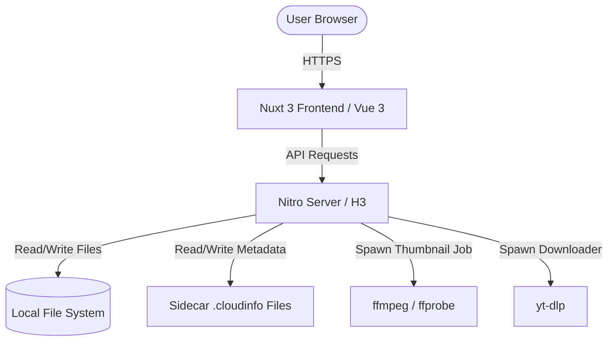

# ClyoCloud Introduction

Welcome to the **ClyoCloud** developer documentation. This guide helps you understand, extend, and deploy ClyoCloud.

## What is ClyoCloud?

ClyoCloud is a personal, self-hosted cloud storage and media management application built for privacy, efficiency, and aesthetics. It provides a lightweight, database-free alternative to mainstream cloud storage providers, allowing users to host, search, stream, and share files directly from their own hardware.

---

## Key Features

*   **Personal Cloud Storage**: Secure hosting on local file systems without databases.
*   **Secure Authentication & 2FA**: Cookie-based JWT authentication with TOTP 2FA options.
*   **Modern File Operations**: Drag-and-drop uploads, context-menu actions, folder creation, on-the-fly zipping, and bulk operations.
*   **Range-Aware Video Streaming**: Built-in HTTP range-request server for seamless scrubbing and streaming.
*   **Rich Media Management**: Async thumbnail/preview generation with FFmpeg/FFprobe, tag organization, and custom descriptions.
*   **Public Sharing**: Generate temporary/permanent unauthenticated public download or preview links.
*   **Background Utilities**: YouTube/media downloading via `yt-dlp`, MD5-based duplicate file identification, and storage cleanup scanning.

---

## Core Design Philosophy: Zero-Database Sidecars

Instead of using a centralized database engine (such as PostgreSQL, MySQL, or SQLite), ClyoCloud relies entirely on **sidecar `.cloudinfo` files**.

### Why Sidecars?

*   **Ultimate Portability**: All metadata (tags, description, public share settings, favorites) is stored inside a JSON file named `<filename>.cloudinfo` directly adjacent to the resource file itself. If a directory is moved, copied, or backed up on the OS level, all metadata automatically migrates with it.
*   **Zero Database Administration**: There is no database server to maintain, no schema migrations to run, and no connection pools to manage.
*   **In-Memory Speed**: To prevent slow disk read operations during search and indexing, ClyoCloud rebuilds an in-memory cache of file tags and statuses on startup. All subsequent page list searches look up this in-memory cache, which is kept in sync during write operations.
