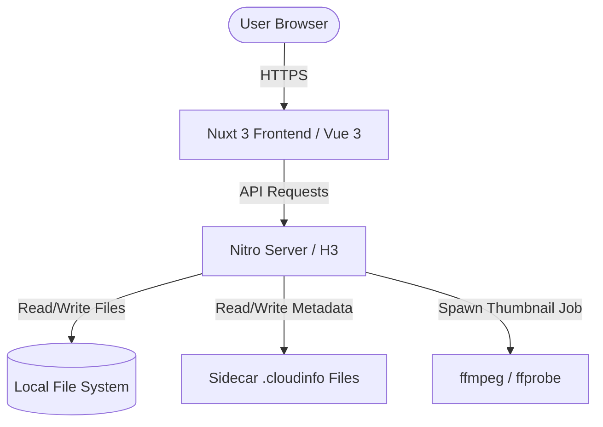

# 🌌 ClyoCloud

<p align="center">
  
</p>

<p align="center">
  <strong>A personal, self-hosted cloud storage and media management application built for privacy, efficiency, and aesthetics.</strong>
</p>

<p align="center">
  <a href="#features"></a>
  <a href="#technologies"></a>
  <a href="#getting-started"></a>
</p>

---

ClyoCloud is designed to be a lightweight, privacy-focused alternative to mainstream cloud storage providers. It allows you to store, organize, stream, and share your files effortlessly from your own hardware, keeping your data entirely under your control.

---

## 🚀 Key Features

*   **🔒 Personal Cloud Storage**: Securely host all your files and media on your own hardware.
*   **🔑 Secure Authentication & 2FA**: Protect your dashboard with TOTP-based Two-Factor Authentication (e.g., Google Authenticator, Authy).
*   **⭐ Favorites & Collections**: Star important items for instant access in a dedicated view, or organize files dynamically using tags.
*   **📝 Activity Tracking**: Stay informed with detailed activity logs capturing file additions, moves, and deletions.
*   **🎨 Advanced Media Management**: Automatic thumbnail generation, file tagging, and descriptions.
*   **🎬 Seamless Video Streaming**: Built-in, range-aware video streaming supporting seamless scrubbing and playback.
*   **🔗 Public Sharing**: Generate public, unauthenticated links easily to share files without giving out account access.
*   **📂 Modern File Operations**: Drag-and-drop uploads, context-menu actions, bulk deletion/downloads, folder creation, and on-the-fly zipping.
*   **📱 Mobile App Integrations**: Scan-to-login connection for Android companion apps to fetch wallpapers or manage cloud files.

---

## 📱 Mobile Companion Apps

ClyoCloud integrates with two dedicated Android companion apps:

*   **🌌 [ClyoCloud Android](https://code.weexnes.dev/ClyoCloudAndroid)**: Complete files, collections, media explorer, and viewer client for your mobile phone.
    *   [ClyoCloudAndroid Repository](https://code.weexnes.dev/ClyoCloudAndroid) | [ClyoCloudAndroid Docs](https://weexnes.dev/project/ClyoCloudAndroid?path=introduction.md) | [APK Download](https://weexnes.dev/project/ClyoCloudAndroid#artifacts)
*   **🖼️ [ClyoWallpaper](https://code.weexnes.dev/ClyoWallpaper)**: Synchronizes with your cloud-curated wallpapers and sets them as your device wallpaper automatically.
    *   [ClyoWallpaper Repository](https://code.weexnes.dev/ClyoWallpaper) | [ClyoWallpaper Docs](https://weexnes.dev/project/ClyoWallpaper?path=introduction.md) | [APK Download](https://weexnes.dev/project/ClyoWallpaper#artifacts)

### 🔑 Secure Quick Login QR Flow
Instead of sharing browser session cookies, generating a QR code registers a unique device token (valid for 365 days) in `devices.json` under your settings profile:
1. Click **Generate Login QR Code** in the settings page.
2. Scan the code in the companion app login screen. The device model name (e.g. `Pixel 7 Pro`) will be registered on the server.
3. You can audit and instantly **Revoke** any device session directly from your settings dashboard.

## 🛠 Tech Stack & Architecture

ClyoCloud leverages a modern, lightweight JavaScript stack to maximize performance and portability.



| Layer | Technology | Purpose |
| :--- | :--- | :--- |
| **Frontend** | **Nuxt 3** (Vue 3 Composition API), **Tailwind CSS**, **DaisyUI** | High-performance, reactive UI with rich user transitions and responsive design. |
| **Backend** | **Nitro** (H3 / Node.js) | Lightweight, minimal HTTP framework handling API endpoints, authentication, and file streams. |
| **Media Processing** | **ffmpeg** & **ffprobe** | Asynchronous generation of thumbnails and previews for video and image files. |
| **Metadata** | Sidecar-based **`.cloudinfo`** files | Portable, zero-database JSON metadata storage living directly alongside your assets. |

---

## 🏁 Getting Started

### 📋 Prerequisites

Before setting up, ensure you have the following installed:
*   [Node.js](https://nodejs.org/) (v18 or higher)
*   [ffmpeg](https://ffmpeg.org/) (installed and available in your system path)

### ⚙️ Configuration

ClyoCloud utilizes environment variables for settings. Create a `.env` file in the root directory:

```env
PORT=6969
STORAGE_PATH=/path/to/your/storage
THUMBNAIL_PATH=/path/to/your/thumbnails
JWT_SECRET=your_secure_random_string_here
```

> [!TIP]
> Ensure the directory paths defined in `STORAGE_PATH` and `THUMBNAIL_PATH` exist and are writeable by the user running the ClyoCloud process.

---

## 💻 Installation

Follow these steps to get your server up and running:

1.  **Clone the Repository**
    ```bash
    git clone <repository-url>
    cd ClyoCloud
    ```

2.  **Install Dependencies**
    ```bash
    npm install
    ```

3.  **Run Development Server**
    ```bash
    npm run dev
    ```
    The application will start in development mode (usually on `http://localhost:3000`).

4.  **Build and Run for Production**
    ```bash
    # Build the production bundle
    npm run build

    # Start the server
    node .output/server/index.mjs
    ```

---

## 🛡 Security & Design Choices

> [!NOTE]
> **Why sidecars instead of a database?**
> ClyoCloud doesn't require a database engine (like SQLite, PostgreSQL, or MongoDB). Instead, metadata is stored in `.cloudinfo` sidecar files directly adjacent to each resource. This choice ensures that your cloud storage remains extremely portable—if you move your folder to another computer, your labels, tags, and favorites move with it automatically!

### Key Security Implementation:
*   **Path Validation**: All user operations are strictly checked to prevent Directory Traversal attacks.
*   **Token Authentication**: API routes are guarded with signed JSON Web Tokens (JWT).
*   **2FA (TOTP)**: Session generation requires a valid two-factor authentication token once configured, protecting your cloud storage from unauthorized logins.

