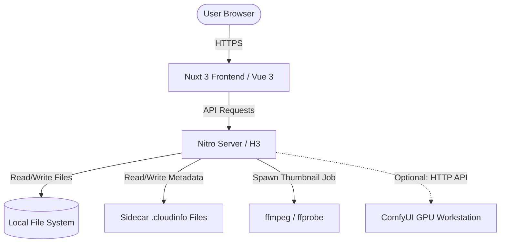

# 🌌 ClyoCloud

<p align="center">
  
</p>

<p align="center">
  <strong>A personal, self-hosted cloud storage and media management application built for privacy, efficiency, and aesthetics.</strong>
</p>

<p align="center">
  <a href="#features"></a>
  <a href="#technologies"></a>
  <a href="#getting-started"></a>
</p>

---

ClyoCloud is designed to be a lightweight, privacy-focused alternative to mainstream cloud storage providers. It allows you to store, organize, stream, and share your files effortlessly from your own hardware, keeping your data entirely under your control.

---

## 🚀 Key Features

*   **🔒 Personal Cloud Storage**: Securely host all your files and media on your own hardware.
*   **🔑 Secure Authentication & 2FA**: Protect your dashboard with TOTP-based Two-Factor Authentication (e.g., Google Authenticator, Authy).
*   **⭐ Favorites & Collections**: Star important items for instant access in a dedicated view, or organize files dynamically using tags.
*   **📝 Activity Tracking**: Stay informed with detailed activity logs capturing file additions, moves, and deletions.
*   **🎨 Advanced Media Management**: Automatic thumbnail generation, file tagging, and descriptions.
*   **🎬 Seamless Video Streaming**: Built-in, range-aware video streaming supporting seamless scrubbing and playback.
*   **🔗 Public Sharing**: Generate public, unauthenticated links easily to share files without giving out account access.
*   **📂 Modern File Operations**: Drag-and-drop uploads, context-menu actions, bulk deletion/downloads, folder creation, and on-the-fly zipping.
*   **📱 Mobile App Integrations**: Scan-to-login connection for Android companion apps to fetch wallpapers or manage cloud files.
*   **🖼️ AI Wallpaper Pipeline (ComfyUI)**: Turn any photo into a 2880×1800 wallpaper. ClyoCloud sends it to your own ComfyUI GPU workstation, which outpaints the sides and upscales it, then stores the result next to the original and adds it to your wallpapers.

---

## 📱 Mobile Companion Apps

ClyoCloud integrates with two dedicated Android companion apps:

*   **🌌 [ClyoCloud Android](https://code.weexnes.dev/ClyoCloudAndroid)**: Complete files, collections, media explorer, and viewer client for your mobile phone.
    *   [ClyoCloudAndroid Repository](https://code.weexnes.dev/ClyoCloudAndroid) | [ClyoCloudAndroid Docs](https://weexnes.dev/project/ClyoCloudAndroid?path=introduction.md) | [APK Download](https://weexnes.dev/project/ClyoCloudAndroid#artifacts)
*   **🖼️ [ClyoWallpaper](https://code.weexnes.dev/ClyoWallpaper)**: Synchronizes with your cloud-curated wallpapers and sets them as your device wallpaper automatically.
    *   [ClyoWallpaper Repository](https://code.weexnes.dev/ClyoWallpaper) | [ClyoWallpaper Docs](https://weexnes.dev/project/ClyoWallpaper?path=introduction.md) | [APK Download](https://weexnes.dev/project/ClyoWallpaper#artifacts)

### 🔑 Secure Quick Login QR Flow
Instead of sharing browser session cookies, generating a QR code registers a unique device token (valid for 365 days) in `devices.json` under your settings profile:
1. Click **Generate Login QR Code** in the settings page.
2. Scan the code in the companion app login screen. The device model name (e.g. `Pixel 7 Pro`) will be registered on the server.
3. You can audit and instantly **Revoke** any device session directly from your settings dashboard.

## 🛠 Tech Stack & Architecture

ClyoCloud leverages a modern, lightweight JavaScript stack to maximize performance and portability.



| Layer | Technology | Purpose |
| :--- | :--- | :--- |
| **Frontend** | **Nuxt 3** (Vue 3 Composition API), **Tailwind CSS**, **DaisyUI** | High-performance, reactive UI with rich user transitions and responsive design. |
| **Backend** | **Nitro** (H3 / Node.js) | Lightweight, minimal HTTP framework handling API endpoints, authentication, and file streams. |
| **Media Processing** | **ffmpeg** & **ffprobe** | Asynchronous generation of thumbnails and previews for video and image files. |
| **Metadata** | Sidecar-based **`.cloudinfo`** files | Portable, zero-database JSON metadata storage living directly alongside your assets. |

---

## 🏁 Getting Started

### 📋 Prerequisites

Before setting up, ensure you have the following installed:
*   [Node.js](https://nodejs.org/) (v18 or higher)
*   [ffmpeg](https://ffmpeg.org/) (installed and available in your system path)

### ⚙️ Configuration

ClyoCloud utilizes environment variables for settings, read when the server starts. Create a `.env` file in the root directory:

```env
PORT=6969
STORAGE_PATH=/path/to/your/storage
THUMBNAIL_PATH=/path/to/your/thumbnails
JWT_SECRET=your_secure_random_string_here
```

`npm run dev` loads `.env` automatically. The production server does not, so pass it when starting (see below) or set the variables in your process manager. Setting them during `npm run build` has no effect. Paths you don't set default to `~/.clyo` of the user running the server.

See the [Setup Guide](.docs/setup-guide.md#environment-variables) for all variables.

> [!TIP]
> Ensure the directory paths defined in `STORAGE_PATH` and `THUMBNAIL_PATH` are writeable by the user running the ClyoCloud process.

---

## 💻 Installation

Follow these steps to get your server up and running:

1.  **Clone the Repository**
    ```bash
    git clone <repository-url>
    cd ClyoCloud
    ```

2.  **Install Dependencies**
    ```bash
    npm install
    ```

3.  **Run Development Server**
    ```bash
    npm run dev
    ```
    The application will start in development mode (usually on `http://localhost:3000`).

4.  **Build and Run for Production**
    ```bash
    # Build the production bundle
    npm run build

    # Start the server, loading settings from .env
    node --env-file=.env .output/server/index.mjs
    ```

---

## 🖼️ ComfyUI Wallpaper Pipeline (optional)

The **Wallpaper V2** pipeline turns a portrait or landscape photo into a 2880×1800 (16:10) wallpaper:

1. The image is scaled to 512×720 and padded by 320 px on each side (`SeamlessPadForOutpaint`, mean fill).
2. Realistic Vision V5.1 Inpainting fills the sides (30 steps, `dpmpp_2m_sde` / Karras, Differential Diffusion), guided by the chosen scene preset (Indoor, Outdoor or Studio).
3. The result is colour-matched to the source (`ColorTransfer`, Reinhard LAB), upscaled with an ESRGAN model and resized to 2880×1800 with Lanczos.
4. A sharp 1280×1800 copy of the original is blended back into the centre with a 160 px feathered mask, so faces and fine detail are never re-generated.

ClyoCloud saves the output as `<name>_2880x1800.png` next to the source, tags it (`Wallpaper`, `2880x1800`, scene, model), marks it as wallpaper and photo widget, and shows it in the Wallpapers tab and companion apps right away. The workflow ClyoCloud sends is [`server/workflows/wallpaper_v2_2880x1800.json`](server/workflows/wallpaper_v2_2880x1800.json) (ComfyUI API format); ClyoCloud only replaces the input image (node `258`), seed (`264`), upscale model (`277`) and the two prompts (`271`, `272`).

ComfyUI does not have to run on the ClyoCloud server. Any machine with a GPU works, as long as the ClyoCloud server can reach it over HTTP.

### 1. Install ComfyUI

Tested with **ComfyUI v0.41.0**. Older versions are missing the core `ColorTransfer` node or the `strength` input of `DifferentialDiffusion`, and the workflow will be rejected.

```bash
git clone https://github.com/comfyanonymous/ComfyUI.git
cd ComfyUI
python -m venv venv
source venv/bin/activate
# Install the PyTorch build for your GPU first, see https://pytorch.org (NVIDIA example:)
pip install torch torchvision torchaudio --index-url https://download.pytorch.org/whl/cu128
pip install -r requirements.txt
```

Roughly 6 GB of VRAM is enough for the SD 1.5 model used here.

### 2. Install the custom node

The workflow uses `SeamlessPadForOutpaint` from the **ComfyUI-EdgePad-Outpaint** node pack, which ships with this repository. Copy it into ComfyUI (it only needs `torch`, which ComfyUI already has):

```bash
cp -r /path/to/ClyoCloud/comfyui/custom_nodes/ComfyUI-EdgePad-Outpaint /path/to/ComfyUI/custom_nodes/
```

Everything else in the workflow (`KSampler`, `InpaintModelConditioning`, `DifferentialDiffusion`, `ColorTransfer`, `UpscaleModelLoader`, `ImageCompositeMasked`, …) is part of core ComfyUI.

### 3. Download the models

Put the files in these folders inside your ComfyUI directory. The file names must match exactly, because they are referenced by name in the workflow.

| Folder | File | Size | Needed |
| :--- | :--- | :--- | :--- |
| `models/checkpoints/` | `Realistic_Vision_V5.1-inpainting.safetensors` | ~4.27 GB | **Required** |
| `models/vae/` | `vae-ft-mse-840000-ema-pruned.safetensors` | ~335 MB | **Required** |
| `models/upscale_models/` | `4x-UltraSharp.pth` | ~67 MB | **Required** (default model) |
| `models/upscale_models/` | `RealESRGAN_x2plus.pth` | ~67 MB | Optional ("RealESRGAN 2x, fast") |
| `models/upscale_models/` | `4x_foolhardy_Remacri.pth` | ~67 MB | Optional ("4x-Remacri, smooth") |

```bash
cd /path/to/ComfyUI
wget -O models/checkpoints/Realistic_Vision_V5.1-inpainting.safetensors \
  https://huggingface.co/SG161222/Realistic_Vision_V5.1_noVAE/resolve/main/Realistic_Vision_V5.1-inpainting.safetensors
wget -O models/vae/vae-ft-mse-840000-ema-pruned.safetensors \
  https://huggingface.co/stabilityai/sd-vae-ft-mse-original/resolve/main/vae-ft-mse-840000-ema-pruned.safetensors
wget -O models/upscale_models/4x-UltraSharp.pth \
  https://huggingface.co/lokcx/4x-Ultrasharp/resolve/main/4x-UltraSharp.pth
# Optional upscalers
wget -O models/upscale_models/RealESRGAN_x2plus.pth \
  https://github.com/xinntao/Real-ESRGAN/releases/download/v0.2.1/RealESRGAN_x2plus.pth
wget -O models/upscale_models/4x_foolhardy_Remacri.pth \
  https://huggingface.co/FacehugmanIII/4x_foolhardy_Remacri/resolve/main/4x_foolhardy_Remacri.pth
```

SHA-256 checksums of the files the pipeline was built with (`sha256sum <file>` to compare):

```text
befb05f117278b063dac594a3406d861c8e148a16db356a95cf0deee25c94cdc  Realistic_Vision_V5.1-inpainting.safetensors
735e4c3a447a3255760d7f86845f09f937809baa529c17370d83e4c3758f3c75  vae-ft-mse-840000-ema-pruned.safetensors
a5812231fc936b42af08a5edba784195495d303d5b3248c24489ef0c4021fe01  4x-UltraSharp.pth
49fafd45f8fd7aa8d31ab2a22d14d91b536c34494a5cfe31eb5d89c2fa266abb  RealESRGAN_x2plus.pth
e1a73bd89c2da1ae494774746398689048b5a892bd9653e146713f9df8bca86a  4x_foolhardy_Remacri.pth
```

Any other upscale model you place in `models/upscale_models/` also shows up in ClyoCloud's model list automatically.

### 4. Start ComfyUI

```bash
# Same machine as ClyoCloud
python main.py --port 8188

# Different machine: listen on the network
python main.py --listen 0.0.0.0 --port 8188
```

> [!WARNING]
> ComfyUI has no authentication. With `--listen 0.0.0.0` anyone who can reach the port can use your GPU and read its outputs. Keep it on a trusted LAN or a private network such as Tailscale/WireGuard, or put it behind an authenticating reverse proxy. Do not expose port 8188 to the internet.

Typical setups:
*   **ClyoCloud and ComfyUI on one machine**: `http://localhost:8188`
*   **Server on your LAN, GPU PC at home**: `http://<pc-lan-ip>:8188`
*   **ClyoCloud on a VPS, GPU PC behind NAT**: join both to Tailscale and use `http://<pc-tailscale-name-or-ip>:8188`, or a private tunnel URL.

### 5. Connect ClyoCloud

1.  Open **Settings → AI Wallpaper Pipeline**, enter the ComfyUI URL and click **Test & save**. ClyoCloud shows the ComfyUI version and GPU, and loads the installed upscale models.
2.  Optionally pick a default upscale model and scene preset.
3.  In **Files**, right-click a JPG, PNG or WebP and choose **Create Wallpaper (2880×1800)**, or use **Create** in the file details. To process several images, select them and click **Wallpaper** in the selection bar. Images run one at a time; tick **Apply to all remaining images** to run the whole batch with the same settings.

Instead of setting the URL per user, you can set a server-wide default with the `COMFYUI_URL` environment variable (for example `COMFYUI_URL=http://100.64.0.2:8188` in `.env`). A URL saved in a user's settings takes precedence.

To check connectivity from the command line:

```bash
python3 scripts/clyo_comfy_bridge.py --comfy http://localhost:8188
```

### Troubleshooting

| Symptom | Cause / fix |
| :--- | :--- |
| `Cannot connect to ComfyUI` | ComfyUI is not running, the URL is wrong, or it only listens on `127.0.0.1` while ClyoCloud runs on another machine (start it with `--listen 0.0.0.0`). |
| `ComfyUI rejected the workflow` mentioning `SeamlessPadForOutpaint` | The EdgePad custom node is not installed in `ComfyUI/custom_nodes/`, or ComfyUI was not restarted after copying it. |
| `… rejected …` mentioning `ColorTransfer` or `DifferentialDiffusion` | ComfyUI is too old. Update it (`git pull && pip install -r requirements.txt`). |
| `Value not in list: ckpt_name` / `vae_name` / `model_name` | A model file is missing or named differently. Compare with the table above. |
| `A wallpaper job is already running` | Each user can run one job at a time. Wait for it to finish (jobs time out after 10 minutes). |
| Visible seam between centre and sides | Try another scene preset, or edit the prompts under **Custom prompts** in the dialog. |

---

## 🛡 Security & Design Choices

> [!NOTE]
> **Why sidecars instead of a database?**
> ClyoCloud doesn't require a database engine (like SQLite, PostgreSQL, or MongoDB). Instead, metadata is stored in `.cloudinfo` sidecar files directly adjacent to each resource. This choice ensures that your cloud storage remains extremely portable—if you move your folder to another computer, your labels, tags, and favorites move with it automatically!

### Key Security Implementation:
*   **Path Validation**: All user operations are strictly checked to prevent Directory Traversal attacks.
*   **Token Authentication**: API routes are guarded with signed JSON Web Tokens (JWT).
*   **2FA (TOTP)**: Session generation requires a valid two-factor authentication token once configured, protecting your cloud storage from unauthorized logins.

